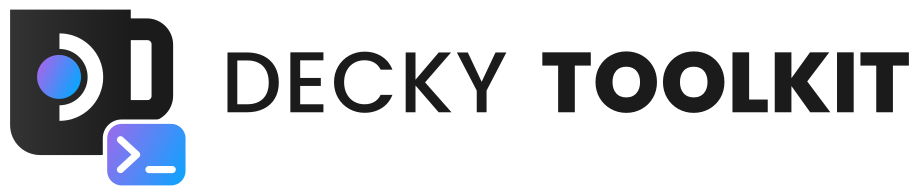
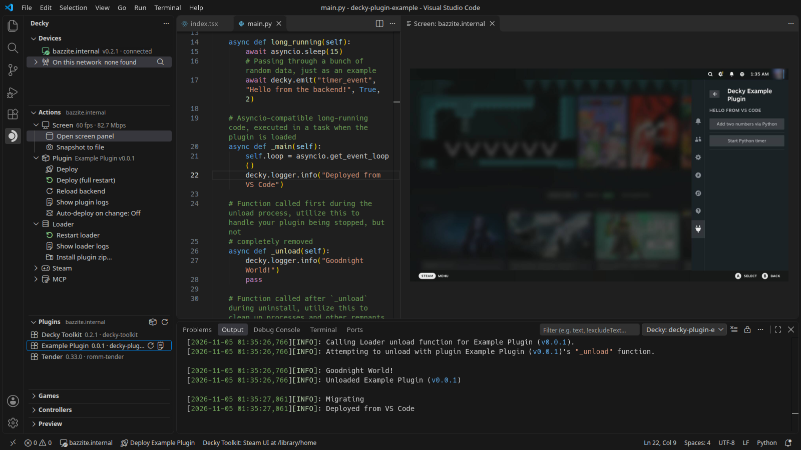
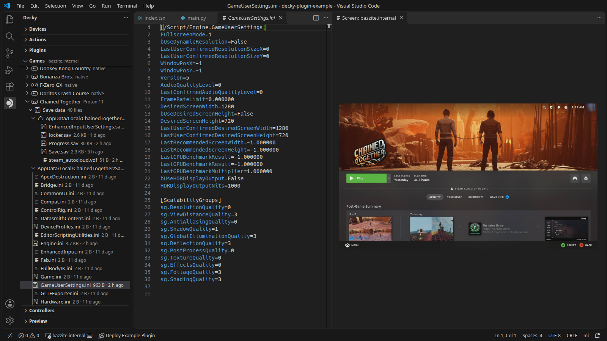
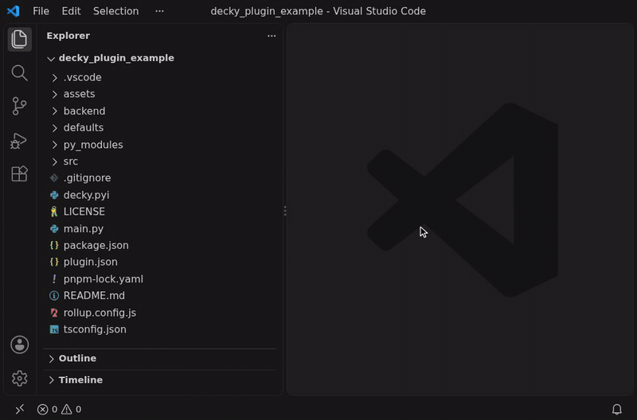

<p align="center">
  <picture>
    <source media="(prefers-color-scheme: dark)" srcset="assets/decky-toolkit-dark.svg">
    <source media="(prefers-color-scheme: light)" srcset="assets/decky-toolkit-light.svg">
    
  </picture>
</p>

<p align="center">
  <b>Build, deploy and test Decky Loader plugins with improved DX and speed straight from your IDE (VSCode / VSCodium)</b>
</p>

<p align="center">
  <a href="LICENSE"></a>
  <a href="https://github.com/jackhric/decky-toolkit/actions/workflows/ci.yml?query=branch%3Amain"></a>
  <a href="https://github.com/jackhric/decky-toolkit/releases"></a>
  <a href="https://marketplace.visualstudio.com/items?itemName=jackhric.decky-toolkit"></a>
  <a href="https://open-vsx.org/extension/jackhric/decky-toolkit"></a>
  <a href="https://www.npmjs.com/package/decky-toolkit"></a>
  
</p>

<p align="center">
  <a href="#features">Features</a> ·
  <a href="#getting-started">Getting started</a> ·
  <a href="extension/README.md">VS Code extension</a> ·
  <a href="docs/reference.md">Reference</a>
</p>

<p align="center">
  
</p>

<p align="center">
  
</p>

## Features

- Live reload your plugin on save for both frontend and backend
- Remote screen with sound and keyboard, mouse and gamepad input
- Decky Loader, plugin and Steam UI logs in VS Code
- Launch games and browse their files and saves
- An extendable MCP server for coding agents: add your plugin's own tools

## Getting started

### Requirements

- A SteamOS or Bazzite device with [Decky Loader](https://github.com/SteamDeckHomebrew/decky-loader) 3.3+.
- VS Code 1.90+ or VSCodium.

### 1. Install the extension

<p align="center">
  
</p>

Or from a terminal:

```sh
code --install-extension jackhric.decky-toolkit
codium --install-extension jackhric.decky-toolkit
```

### 2. Install the Decky Plugin

1. On the device turn on Decky settings → **General** → **Other** → **Developer mode**.
2. Open **Developer** → **Third-Party Plugins** → **Install Plugin from URL**.
3. Enter `jackhric.github.io/decky-toolkit/decky-toolkit.zip` and press **Install**.

### 3. Pair

1. In VS Code click the **Decky** icon in the Activity Bar and add the device's IP address with **+**.
2. Click the device. VS Code shows a four-digit code.
3. On the device open Quick Access → **Decky Toolkit** and approve the matching code.

### 4. Deploy

Open your plugin's folder and press <kbd>Ctrl</kbd>+<kbd>Alt</kbd>+<kbd>D</kbd>
(<kbd>Cmd</kbd>+<kbd>Alt</kbd>+<kbd>D</kbd> on macOS) or click **Deploy** in the status bar.

See the [extension guide](extension/README.md) and the [reference](docs/reference.md) for more.

## AI Disclaimer

This project was built with heavy use of [Claude Code](https://claude.com/claude-code). The Decky
Plugin Store does not accept LLM-generated code
([guidelines](https://wiki.deckbrew.xyz/en/plugin-dev/submitting-plugins#ai-llms-and-so-on)) so it is
not listed there.

## License

[MIT](LICENSE)
