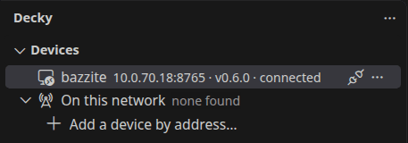
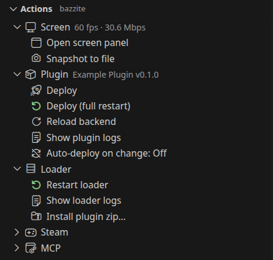
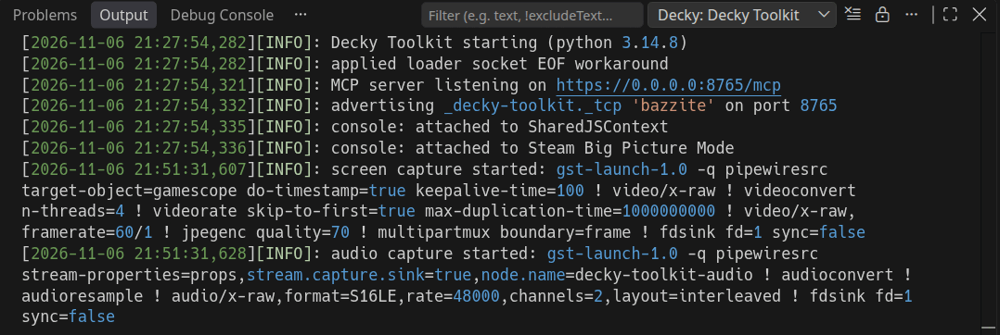
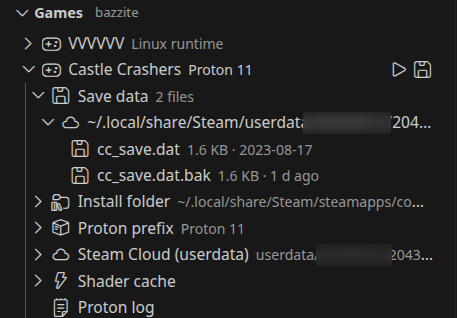
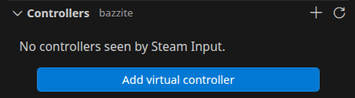

Everything lives in the **Decky** sidebar. Every action is also in the command palette under **Decky:**.

## Devices

The **Devices** view shows your device and whether it is connected.



- **On this network** lists devices the extension found by itself
- **Search network** (magnifier in the title) searches again
- **Add device** (+) adds a device by address, for a device on another network
- Click a device to connect, pairing first if needed
- Right-click for **Rename device** and **Forget device**

The search finds devices on your computer's own network only. Turn it off with the `decky-toolkit.discovery.enabled`
setting.

## Actions

Once connected, the **Actions** view holds the things you do most.



- **Screen**: **Open screen panel**, **Snapshot to file**
- **Plugin**: **Deploy**, **Deploy (full restart)**, **Reload backend**, **Show plugin logs**, **Auto-deploy on change**
- **Loader**: **Restart loader**, **Show loader logs**, **Install plugin zip…**
- **Steam**: **Navigate to…**, **Open save data…**, **Open plugin panel…**, **Back**, **Quick Access**,
  **Close menus**, **Evaluate JS in Steam UI**, **Toast on device**
- **MCP**: **Write MCP config for this workspace**, **Copy MCP URL**

The Plugin group works on the plugin open in your workspace. See [Deploy and live reload](../deploy/).

## Screen

**Open screen panel** shows the device's screen with sound in an editor tab, and lets you use it with your keyboard,
mouse and gamepad. See [Screen and input](../screen/).

## Logs

**Show plugin logs** and **Show loader logs** follow the logs live in the Output panel. Build output from a deploy goes
to the **Decky** channel.



The **Plugins** view lists every plugin on the device. Its icons reload a plugin or open its log.

## Game files and saves

The **Games** view lists the games installed on the device. Expand one to see its save data, install folder,
Proton prefix and Proton log.



- Click a file to open it in an editor tab; saving writes it back to the device
- **Find game…** searches the list by name
- **Open save data…** adds a game's save folder to the Explorer
- **Open device path…** opens any folder or file on the device
- The play icon launches a game; a running game gets a stop icon

Device files open as `decky://<address>/<path>`, so you can edit them like local files. The device only lets you
change game folders, Proton prefixes and save folders.

## Controllers

The **Controllers** view lists every controller Steam Input sees on the device.



- **Add virtual controller** (+) adds an Xbox 360 pad that Steam treats like a real one, up to four
- The trash icon removes a virtual pad

Your own gamepad can drive one of these pads from the screen panel.

## Console

**Evaluate JS in Steam UI** runs a JavaScript expression in the Steam UI, where Decky plugin frontends run, and shows
the result. Long results go to the **Decky Toolkit Console** output channel.

```js
location.pathname
// '/routes/library/home'
```

**Toast on device** shows a Decky toast with your text.

:::caution
Anyone you pair can run code on the device. Use Decky Toolkit on a network you trust.
:::
