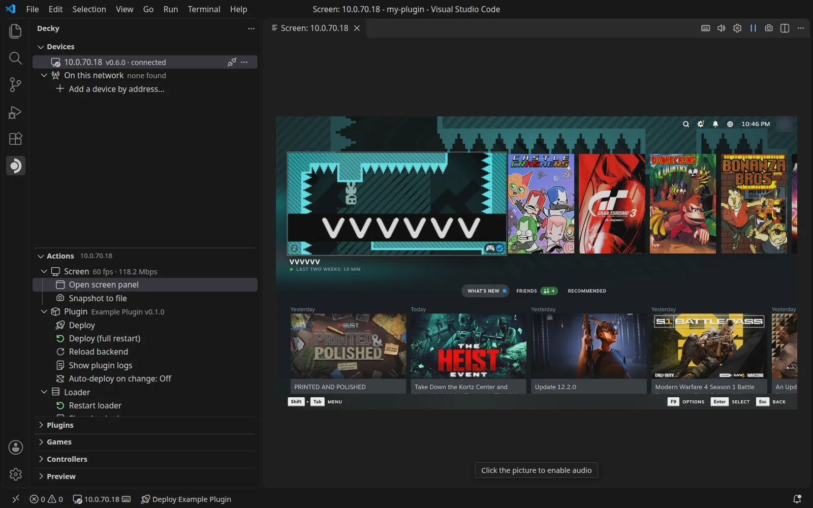

Click **Open screen panel** in the Actions view, or run **Decky: Open screen**. The device's screen opens in an editor
tab, with sound.

## Title bar buttons

The panel shows only the picture. Its buttons are in the editor title bar:

| Button | What it does |
| --- | --- |
| Keyboard | **Turn on remote input** / **Turn off remote input** |
| Speaker | **Mute** / **Unmute** sound on your computer |
| Gear | **Stream settings…** |
| Pause | **Pause** / **Resume** the picture |
| Camera | **Snapshot to file** saves the current frame |

**Stream settings…** sets the frame rate, quality, size and sound for everyone watching, plus the volume and
**Gamepad goes to** for your computer only.

## Use the device remotely

Remote input is off until you turn it on with the keyboard button. You can also turn it on with
**Decky: Toggle remote input**, or with **Allow remote input** in the plugin's settings on the device.

- Click the picture, then use your mouse and keyboard
- Click outside the picture to give the keyboard back to VS Code
- A gamepad on your computer works while the panel has focus; the device sees an Xbox 360 pad
- **Gamepad goes to** picks which pad on the device your gamepad drives

**Decky: Navigate Steam UI to…** jumps to any Steam or Decky page, a game's page or a plugin's panel.

:::caution
Remote input is full control of the device. The device shows a toast when someone starts sending input.
:::
