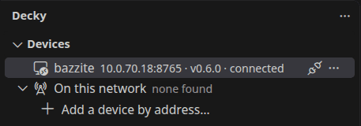
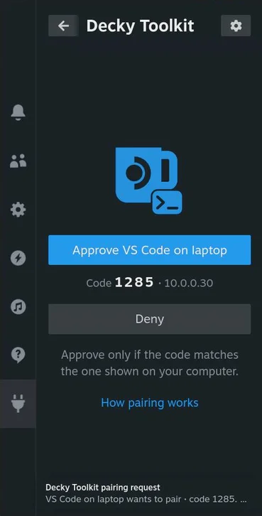

You need a SteamOS device with [Decky Loader](https://github.com/SteamDeckHomebrew/decky-loader) 3.3 or newer,
and VS Code 1.90+ or VSCodium on your computer. Both must be on the same network.

## 1. Install the plugin on the device

1. On the device, open Decky's settings and turn on **General → Other → Developer mode**.
2. Open **Developer → Third-Party Plugins → Install Plugin from URL**.
3. Enter this address and press **Install**:

   ```text
   https://jackhric.github.io/decky-toolkit/decky-toolkit.zip
   ```

4. Confirm the warnings.

Open Quick Access (…) → **Decky Toolkit**. The panel shows the device's address.

## 2. Install the extension

Search for **Decky Toolkit** in the Extensions view, or run:

```sh
code --install-extension jackhric.decky-toolkit     # VS Code
codium --install-extension jackhric.decky-toolkit   # VSCodium
```

## 3. Find the device

Click the **Decky** icon in the Activity Bar. The extension searches your network. A device on the same network
appears under **On this network**.

On another network, click **Add a device by address…** and enter the address from the device's panel.



_A device that is already paired. It is on another network, so it was added by address._

## 4. Pair

1. Click the device. VS Code shows a four-digit code.
2. On the device, open Quick Access → **Decky Toolkit**.
3. Check that the code matches and press **Approve**.



You only pair once. The extension connects by itself next time.

## 5. Deploy your plugin

Open your plugin's folder (any folder with a `plugin.json`) and press <kbd>Ctrl</kbd>+<kbd>Alt</kbd>+<kbd>D</kbd>
(<kbd>Cmd</kbd>+<kbd>Alt</kbd>+<kbd>D</kbd> on macOS). Your plugin is built if needed, installed and loaded.

## Next

- [Use the extension](../features/extension/): screen, logs, game files, controllers
- [Deploy and live reload](../features/deploy/): reload your plugin on every save
- [CLI and MCP](../features/cli/): give a coding agent your device
