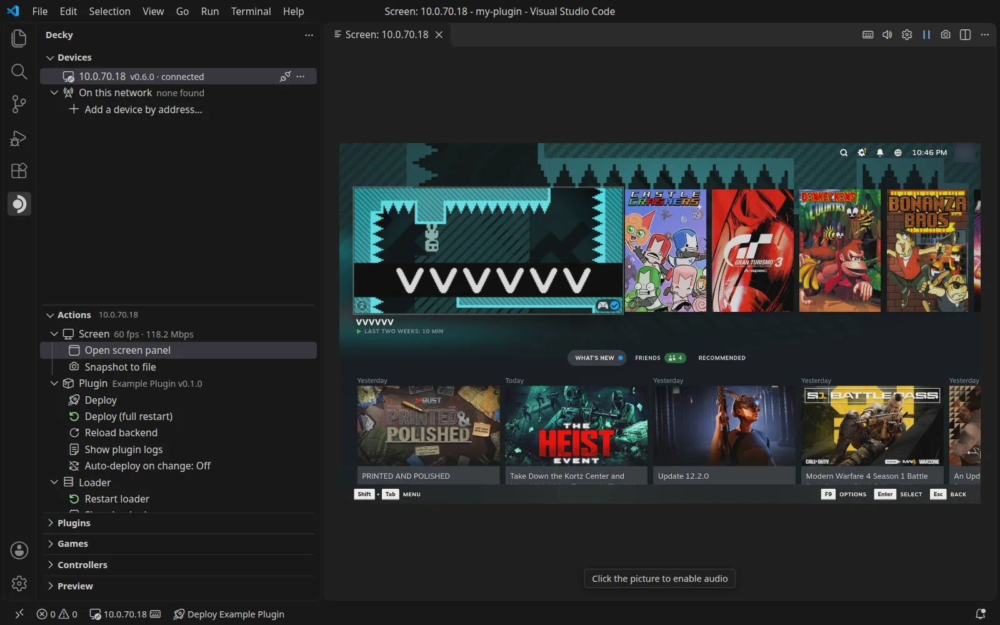

import { LinkCard } from '@astrojs/starlight/components';

Decky Toolkit lets you build, test and deploy Decky Loader plugins on your SteamOS device from VS Code or VSCodium.
It has three parts:

- A Decky Loader plugin on the device
- A VS Code extension that deploys your plugin, shows the device's screen and streams its logs
- A command line tool that gives coding agents such as Claude Code the device over MCP

<LinkCard title="Quick start" description="Install, pair and deploy your first plugin." href="getting-started/" />
<LinkCard title="Use the extension" description="Devices, logs, game files, controllers and the console." href="features/extension/" />
<LinkCard title="Deploy and live reload" description="Reload your plugin on every save." href="features/deploy/" />
<LinkCard title="Screen and input" description="See and use the device from your editor." href="features/screen/" />
<LinkCard title="CLI and MCP" description="Connect Claude Code or any MCP client." href="features/cli/" />
<LinkCard title="Your plugin's own tools" description="Let agents call into your plugin." href="features/plugin-tools/" />
